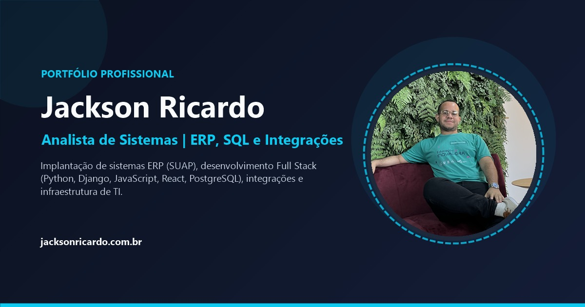

# 👨‍💻 Portfólio Profissional | Jackson Ricardo



Este é o repositório do meu portfólio pessoal e profissional ([jacksonricardo.com.br](https://jacksonricardo.com.br)). O objetivo deste site é apresentar minha trajetória, experiências profissionais, formação acadêmica, habilidades técnicas e projetos nas áreas de **Análise de Sistemas, ERP (SUAP/TOTVS), SQL, Desenvolvimento Full Stack (Python, Django, JavaScript, React, PostgreSQL), Integrações e Infraestrutura de TI**.

---

## 🌐 Demonstração Online

- **Site Oficial:** [https://jacksonricardo.com.br](https://jacksonricardo.com.br)
- **Repositório:** [https://github.com/JacksonRicardo/Portfolio2026](https://github.com/JacksonRicardo/Portfolio2026)

---

## 🚀 Funcionalidades

- **Tema Escuro e Claro (Dark & Light Mode):** Alternância suave entre o tema escuro padrão e o tema claro, com salvamento automático da preferência do visitante no `localStorage`.
- **Tradução Bilíngue (PT-BR / EN):** Botão de troca instantânea de idioma entre Português e Inglês em todas as seções do portfólio, também persistido no `localStorage`.
- **Download Direto de Currículo:** Botão integrado na seção principal para baixar o currículo atualizado em PDF (`Curriculo_Jackson_Ricardo.pdf`).
- **Prévia Rica para Redes Sociais (Open Graph & Twitter Cards):** Meta tags configuradas com imagem de capa dedicada (`fotos/og-preview.jpg` em `1200x630`) para exibição no LinkedIn, WhatsApp e outras redes.
- **100% Responsivo:** Layout adaptável para smartphones, tablets e desktops.
- **Timeline de Experiências:** Exibição cronológica e vertical da trajetória profissional no SENAC, Grupo Salta Educação, Service Rapide, FUNCERN (projetos UFR e IFMT), IMD, IFRN, MPRN e Secretaria Municipal de Saúde de Natal.
- **Organização em Cards:** Formação acadêmica, pós-graduações, habilidades, áreas de conhecimento, projetos em destaque e recomendações profissionais estruturados para leitura rápida.

---

## 🛠️ Tecnologias Utilizadas

O projeto foi construído focando em alta performance, acessibilidade e facilidade de manutenção:

- **HTML5** — Estrutura semântica e metadados SEO / Open Graph.
- **CSS3** — Estilização personalizada com variáveis CSS (`Custom Properties`) para suporte nativo a múltiplos temas, animações e responsividade.
- **JavaScript (Vanilla ES6+)** — Gerenciamento de estado de tema (Claro/Escuro), dicionário de internacionalização (PT/EN) e efeitos de navegação.
- **Bootstrap 5 (via CDN)** — Sistema de grid responsivo e componentes utilitários.
- **FontAwesome 6 (via CDN)** — Ícones vetoriais.
- **Google Fonts** — Tipografia moderna (*Inter* e *Poppins*).

---

## ⚙️ Como Executar o Projeto

Como o projeto utiliza HTML, CSS e JavaScript nativos, não há necessidade de etapas de build ou instalação de dependências:

1. **Clone este repositório:**
   ```bash
   git clone https://github.com/JacksonRicardo/Portfolio2026.git
   ```

2. **Execute localmente:**
   - Acesse a pasta `Portfolio2026` e abra o arquivo `index.html` diretamente no navegador de sua preferência.

3. **Hospedagem:**
   - Basta publicar os arquivos na raiz do seu servidor web (Apache, Nginx, GitHub Pages, Vercel ou Netlify).

---

## 🗂️ Estrutura de Arquivos

```text
Portfolio2026/
├── fotos/
│   ├── perfil.jpg                     # Foto de perfil principal (Hero)
│   └── og-preview.jpg                 # Imagem de prévia Open Graph (1200x630) para LinkedIn/WhatsApp
├── Curriculo_Jackson_Ricardo.pdf      # Currículo em PDF disponível para download
├── index.html                         # Aplicação principal (HTML, CSS e JS de temas/tradução)
└── README.md                          # Documentação do projeto
```

---

## 📞 Contato

Fique à vontade para entrar em contato comigo:

- **LinkedIn:** [linkedin.com/in/jackson-r100](https://www.linkedin.com/in/jackson-r100/)
- **GitHub:** [github.com/JacksonRicardo](https://github.com/JacksonRicardo/)
- **Email:** [jackson2016.ricardo@gmail.com](mailto:jackson2016.ricardo@gmail.com)
- **WhatsApp / Telefone:** (84) 98866-7338
- **Localização:** Natal - RN, Brasil

---

Desenvolvido com dedicação por **Jackson Ricardo**.
